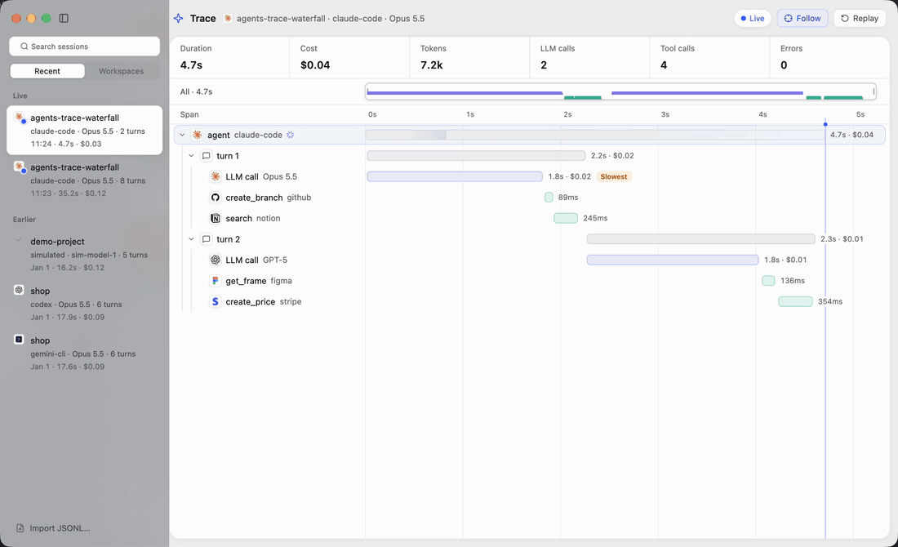
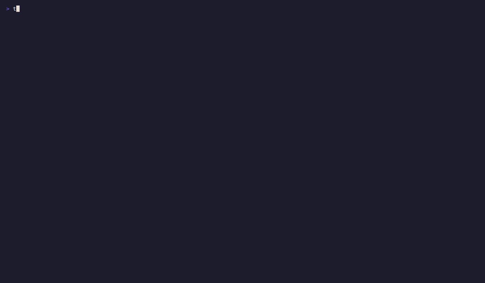

# Agents Trace Waterfall

A local-first terminal trace waterfall for coding agents. It shows runs, turns, LLM calls, tool calls, subagents, and waits on one shared time axis. You can watch a run live, browse it later, or replay it on a virtual clock.





See [spec.md](spec.md) for the design, [docs/protocol.md](docs/protocol.md) for the collector protocol, and [docs/privacy.md](docs/privacy.md) for what is recorded.

## Quick start

```sh
cargo build --release
export PATH="$PWD/target/release:$PATH"

# Browse a recorded trace.
trace-tui import examples/sample-trace.jsonl
trace-tui

# Watch a simulated agent live.
trace-tui collector start &
simulated-live --socket
trace-tui live

# Record your agents' sessions as they happen (metadata only).
trace-tui collector start \
  --tail claude-code=$HOME/.claude/projects \
  --tail codex=$HOME/.codex/sessions \
  --tail pi=$HOME/.pi/agent/sessions \
  --tail omp=$HOME/.omp/agent/sessions \
  --tail opencode=$HOME/.local/share/opencode/opencode.db
```

## Supported harnesses

| Harness | Adapter | Reads | Notes |
|---|---|---|---|
| Claude Code | `claude-code` | `~/.claude/projects/**/*.jsonl` | Sub-agents nest under the tool call that launched them. |
| Codex CLI | `codex` | `~/.codex/sessions/**/rollout-*.jsonl` (also `.jsonl.zst`; archived ones in `~/.codex/archived_sessions`) | Commands, file changes, MCP calls and web searches keep Codex's own timings. Sub-agent threads join the root session under their `spawn_agent` call. |
| pi | `pi` | `~/.pi/agent/sessions/**/*.jsonl` | Model calls carry pi's request timing and cost estimate. Branches are marked. Sub-agent sessions started during a tool call nest under it, live; runs of pi's sub-agent extension nest once the call returns. Forks and clones stay their own sessions. |
| Oh My Pi | `omp` | `~/.omp/agent/sessions/**/*.jsonl` | pi's format and features, with Oh My Pi's own timing fields. |
| OpenCode | `opencode` | `~/.local/share/opencode/opencode.db` (`opencode-<channel>.db` on other release channels), or `~/.local/share/opencode/storage` for 1.x | Read-only; sessions are re-read as they change. Every SQLite version, and 1.x's JSON files. Sub-agent sessions nest under the task call that started them. |
| Kilo Code | `kilo` | `~/.local/share/kilo/kilo.db` | OpenCode's format; read the same way. |
| Gemini CLI | `gemini-cli` | `~/.gemini/tmp/*/chats/` (`session-*.jsonl`, older `session-*.json`) | Sub-agents nest under their `invoke_agent` call once it returns. Call starts are inferred from the message before. |
| Qwen Code | `qwen-code` | `~/.qwen/projects/*/chats/*.jsonl` | Sub-agents rebuilt from the parent's telemetry records, with model and timing. Background agents stay open. |
| GitHub Copilot CLI | `copilot` | `~/.copilot/session-state/*/events.jsonl` | Output tokens only: the log has no input tokens. For full usage, export OpenTelemetry (`COPILOT_OTEL_ENABLED=1`) to the receiver. |
| Cline | `cline` | `~/.cline/data` (Cline 4.x), or VS Code's `globalStorage/saoudrizwan.claude-dev/tasks` | Both formats. Sub-agents of the classic extension record only their totals. |
| Roo Code | `roo` | VS Code's `globalStorage/rooveterinaryinc.roo-cline/tasks` | Child tasks nest under their `newTask` call. Roo records no model name. |
| Kimi Code | `kimi-code` | `~/.kimi-code` | Turns, steps, tools and sub-agents with Kimi Code's own stream timing. |
| Kimi CLI | `kimi` | `~/.kimi` | The archived Python CLI. Its log names no model; it comes from `config.toml`. |
| Crush | `crush` | `~/.local/share/crush/projects.json` (every project), or a project's `.crush/crush.db` | No tokens per call: the session's running cost sits on the session. |
| OpenClaw | `openclaw` | `~/.openclaw` | pi's format, stored in SQLite. |
| Hermes Agent | `hermes` | `~/.hermes/state.db` | Tokens and cost per session, not per call. Delegated sub-agents nest under `delegate_task`. |
| Grok CLI | `grok` | `~/.grok/sessions` | xAI's CLI. Tokens per turn, not per call. |
| Any OpenTelemetry exporter | `otlp` | `otlp = "127.0.0.1:4318"` in the config, or a file of OTLP JSON requests | GenAI and OpenInference span conventions, JSON or protobuf. Verified with Goose and Qwen Code. |

Every harness nests its sub-agents inside the parent's trace, so one session shows the whole run. `crates/trace-ingest/tests/conformance.rs` records one scenario in each harness's own format and checks every adapter yields the same trace; each adapter has also been checked against real sessions, sub-agents included.

Costs a harness doesn't report are estimated from the model's API list price (Claude and GPT-5 / GPT-4 models, cache reads and writes included) and shown as `~$1.20`. On a subscription plan this is what the same usage would cost through the API, not what you are billed. Unknown models stay `—`.

Every adapter records metadata only: turns, model calls, tool names, timings, tokens and cost, never prompt, response or tool text. Any other harness can send events directly through `trace-adapter-sdk` or the socket protocol in [docs/protocol.md](docs/protocol.md). `trace-tui doctor` lists what each adapter cannot observe.

## Desktop app

`agents-trace-waterfall` is a native macOS app built with GPUI and gpui-kit. It reads the same database as the TUI and follows the system light or dark appearance. See [docs/design.md](docs/design.md) for its design.

```sh
scripts/bundle.sh                                       # builds target/release/Agents Trace Waterfall.app with its icon
open "target/release/Agents Trace Waterfall.app"
./target/release/agents-trace-waterfall                 # or run the binary directly
./target/release/agents-trace-waterfall --open 7ad34f22 # open a session by id prefix
```

Click a span for its details. Drag the overview strip to move through long sessions. Drop a `.jsonl` file on the window to import it. The keyboard shortcuts match the TUI.

The Context button (or `c`, as in the TUI) opens a context map beside the waterfall: a treemap of what fills the main agent's context window at the selected span, sized from token usage, with the free space up to the model's window and how often the session compacted.

## Commands

| Command | Purpose |
|---|---|
| `trace-tui` | Sessions overview. |
| `trace-tui live` | Sessions overview filtered to live runs. |
| `trace-tui open <id>` | Open a session's waterfall. Accepts a unique id prefix. |
| `trace-tui replay <id> --speed 2` | Replay a session on a virtual clock. |
| `trace-tui import <file> [--adapter <name>]` | Import a transcript, database or session folder; `doctor` lists the adapters. |
| `trace-tui export <id> [-o file]` | Write the normalized journal as JSONL. |
| `trace-tui collector start [--tail adapter=path]` | Run the ingestion daemon. Without `--tail` or `[[tail]]`, it watches every harness's default location found. The desktop app runs one itself when none is running. |
| `trace-tui doctor` | Check storage, socket, collector, and adapters. |
| `trace-tui purge` | Apply retention. |

Press `?` in the TUI for the keymap.

## Configuration

`~/.config/agents-trace-waterfall/config.toml`, or the file named by `AGENTS_TRACE_WATERFALL_CONFIG`:

```toml
db = "~/.local/share/agents-trace-waterfall/traces.db"  # or AGENTS_TRACE_WATERFALL_DB
# socket = "..."                                         # or AGENTS_TRACE_WATERFALL_SOCKET; default is per-user, see docs/protocol.md
theme = "default"                                        # ascii, monochrome, ascii-monochrome

[retention]
metadata_days = 90
payload_days = 30

[capture]
payloads = false
projects = []

[[tail]]
adapter = "claude-code"
path = "~/.claude/projects"

[[tail]]
adapter = "codex"
path = "~/.codex/sessions"
```

## Layout

| Crate | Owns |
|---|---|
| `trace-core` | Domain types, the reducer shared by live and replay, ordering, cost rules. |
| `trace-storage` | SQLite journal, projections, retention, redaction. |
| `trace-ingest` | Collector daemon, socket server, harness adapters, OpenTelemetry receiver. |
| `trace-render` | Waterfall widget, time axis, tree flattening, clipping. |
| `trace-view` | The session document shared by the TUI and the desktop app: live polling, replay, folding, viewport. |
| `trace-tui` | CLI and Ratatui app. |
| `trace-app` | GPUI desktop app (`agents-trace-waterfall`). |
| `trace-adapter-sdk` | Harness integration: recorder, socket client, JSONL helpers. Depends only on `trace-core`. |
| `examples/simulated-live` | Deterministic agent run generator for demos, fixtures, and perf tests. |

Run `cargo test --workspace` to check everything.
